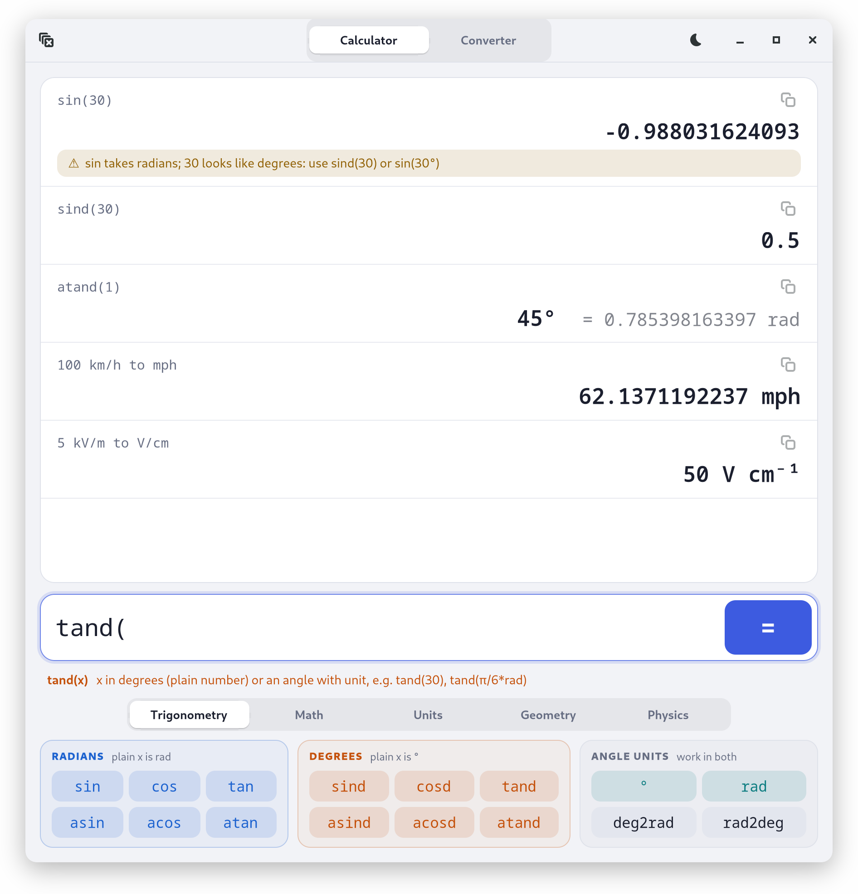

# JuliaCalc

Calculator and unit converter (GTK 4 desktop app) built on
[Unitful.jl](https://github.com/PainterQubits/Unitful.jl), with explicit angle units,
geometry helpers and a triangle solver. Ships as a self-contained `.deb` for Ubuntu 20.04+.

<p align="center">
  <picture>
    <source media="(prefers-color-scheme: dark)" srcset="docs/screenshot-dark.png">
    
  </picture>
</p>

## Run from source (debug mode)

```sh
julia --project -e 'using Pkg; Pkg.instantiate()'   # first time only
./dev.sh                                             # open the window
./dev.sh "100 km/h to mph" "sind(30)"                # or evaluate in the terminal
```

`./dev.sh` runs straight from `src/`, so you can edit, close the window and run it again
(about 10 s per start). Every evaluation, its hints and full stack traces are printed to the
terminal. Tests: `julia --project -e 'using Pkg; Pkg.test()'`.
Headless (Xvfb) screenshots need `GSK_RENDERER=cairo`: GTK's GL renderer on Xvfb's software
GL can leave the first frame black.

## Angles

| You type | Means |
|---|---|
| `sin(x)` `cos` `tan` `sec` `csc` `cot` | plain `x` is **radians** |
| `sind(x)` `cosd` `tand` `secd` `cscd` `cotd` | plain `x` is **degrees** |
| `sin(30°)`, `sind(0.5rad)`, `tan(45deg)` | an angle with a unit is converted, so it is right in both families |
| `asin acos atan ...` / `asind acosd atand ...` | return a tagged angle (`rad` / `°`); results show both units |
| `atan(y, x)`, `atand(y, x)` | two-argument forms, also for lengths |
| `deg2rad(x)`, `rad2deg(x)` | return tagged angles |

Plain numbers are radians everywhere else (SI: rad = 1), so `1 to deg` gives `57.2958°`.
Calls that look like the wrong family get a hint: `sin(30)` suggests `sind(30)` or
`sin(30°)`; `sind(π/4)` suggests `sin(π/4)`. `45° + 10` is refused, because the plain 10
would silently be radians: write `10°` or `10rad`. Outside the trig functions (`triangle`,
`arc`, `cart`), angles must carry a unit.

## Units

Any [Unitful unit](https://painterqubits.github.io/Unitful.jl/stable/defaultunits/) and SI
prefix works by name, as do its physical constants (`c0 G gn k q Na R me mp ε0 μ0 σ`).
A space between a number and a unit multiplies: `100 km/h`. Convert with `to`
(`3 ft + 2 inch to cm`) or `|>` (`5km |> mi`). Temperatures are affine: `100 degF to degC`.

Easier spellings: `deg` (°), `degC`, `degF`, `ohm` (Ω), `um` (μm), `us` (μs), `h` (hour;
Planck's constant is `planck`), `min` (minutes, while `min(3, 4)` is still the function),
`kph`. Added units: `nmi kn mph gal` (US) `t` (tonne) `au ly hp Wh kWh`.
SI prefixes work on everything that takes them: `5 kV/m to V/cm`, `1 J to MeV`, `3 GHz to Hz`.
Your own variables take priority: after `m = 5`, `m` is 5 in that session (a hint says so).
`si(x)` converts to SI base units.

## Geometry

Each function returns all derived values at once; lengths may have units.
`circle(r)`, `sphere(r)`, `cylinder(r, h)`, `cone(r, h)`, `rectangle(a, b)`, `box(a, b, c)`,
`arc(r, θ)`, `polar(x, y)`, `cart(r, θ)`, `dist(p, q)`, `hypot(a, b)`.
`triangle(a=3, b=4, C=90°)` solves any triangle from 3 values (at least one side), with side
`a` opposite angle `A`. It handles SSS, SAS, ASA, AAS and SSA, and reports the second solution of
an ambiguous SSA case as a hint.

## Physics

`photon(x)` takes a wavelength, frequency, energy or wavenumber and returns all four
(E = hν = hc/λ). Each comes in a readable unit (`photon(1MeV).λ` is `1.24 pm`), and
`photon(500nm).E to J` converts further. This equivalence is opt-in: a plain
`500 nm to eV` is a dimension error, not a silent physics conversion.

## Using the window

Enter runs, ↑/↓ recall earlier inputs, Esc clears, clicking an earlier input puts it
back in the entry, and results can be selected and copied. Buttons insert at the cursor.
Radian functions are blue and degree functions orange, and every button's tooltip shows its
signature. The line under the input shows the signature of the function you are typing.
**Clear** (top left) forgets the history and the variables; the sun/moon button switches
between light and dark, and the choice is saved in `~/.config/juliacalc/theme` (default:
the desktop's preference).

The **Converter** tab shows a value in every unit of a category (Length ... Energy, Electric
field, Charge, Magnetic field, Photon λ ν E). The value may be an expression or carry its own
unit: typing `5 kV/m` jumps to Electric field. The **to** field converts to any unit you type
(`V/cm`, `MeV`, `ft/s`), even when no category has it. Clicking a row converts from that unit;
the copy buttons copy a value.

## Build and install the .deb

```sh
julia --project=packaging -e 'using Pkg; Pkg.instantiate()'   # first time only
xvfb-run -a julia --project=packaging packaging/build_deb.jl   # writes dist/juliacalc_<version>_amd64.deb
sudo apt install ./dist/juliacalc_*_amd64.deb                  # remove: sudo apt remove juliacalc
```

The package installs the app in `/opt/juliacalc`, the `juliacalc` command and a menu entry.
It bundles Julia and GTK 4, so the target needs neither. The version comes from `Project.toml`:
bump it before building a package to install over an older one, because apt skips a `.deb`
whose version is already installed.
`juliacalc "expr"` evaluates in the terminal without opening the window.

`/usr/bin/juliacalc` starts the app through Julia's own `julia` binary (built against an old
glibc) because PackageCompiler's launcher is linked against the build host's glibc and would
not start on 20.04. It also puts a per-user depot (`~/.cache/juliacalc`) first, since GTK
writes a cache on first start and `/opt` is read-only.

Startup (window in ~0.7 s) depends on two build workloads that compile the app into its image:
`packaging/precompile.jl` drives the real window in a separate process, and
`packaging/warmup.jl` runs the engine and every converter category inside the process that
writes the image. The second is needed because PackageCompiler silently drops recorded
`precompile` statements that mention Unitful types (Julia prints them in a form it cannot
parse back). Without it, the window took ~7 s to appear, almost all of it compiling. To check
after changes, run with `--trace-compile=stderr` and see what still compiles at launch.

## Layout

| File | Contents |
|---|---|
| `src/units.jl` | extra units, ASCII aliases, name lookup, photon equivalence, converter categories |
| `src/angles.jl`, `src/geometry.jl`, `src/physics.jl` | angle rules, geometry, `photon` (inside `module Space`, `src/space.jl`) |
| `src/engine.jl` | sessions and evaluation of one input line |
| `src/format.jl` | how results are shown |
| `src/gui.jl` | the GTK window |
| `packaging/` | the `.deb` build (PackageCompiler), launcher, desktop entry; `icons/` holds the app icon (generated with Codex `image_gen`, 1024 px source plus 256/512 px exports) |
